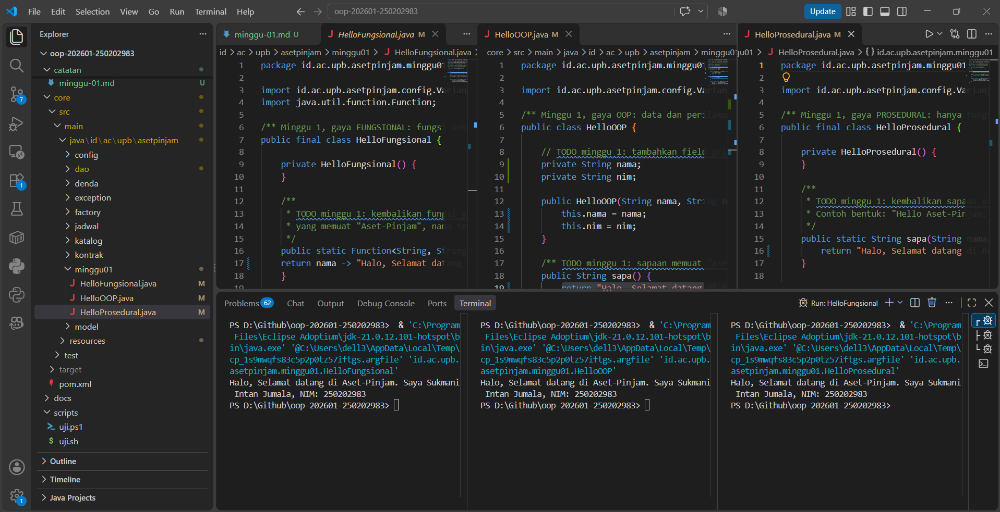
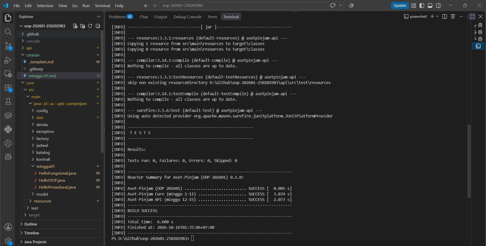

# Catatan Minggu NN: Paradigma Pemrograman dan Setup

## Yang saya kerjakan

Langkah pertama yang saya kerjakan yaitu menginstall JDK 21 dan Maven. Berikutnya melengkapi pada bagian `core/src/main/resources/mahasiswa.properties`

Selanjutnya saya mengerjakan pada bagian `core/src/main/java/id/ac/upb/asetpinjam/minggu01/HelloProsedural.java`, `HelloOOP.java`, `HelloFungsional.java` dan menentukan kalimat sapaan untuk menghasilkan output yang sama.

Kemudian saya menambahkan kode pada bagian yang tertera `TODO`:

- `HelloFungsional.java`
  Saya menggunakan lambda expression untuk membuat fungsi yang menerima nama dan menghasilkan kalimat sapaan

```java
return nama -> "Halo, Selamat datang di Aset-Pinjam. Saya " + nama + ", NIM: " + nim;
```

- `HelloOOP.java`
  Saya menggunakan field private untuk menyimpan nama dan NIM, lalu mengisi nilainya melalui konstruktor

```java
private String nama;
private String nim;
```

```java
this.nama = nama;
this.nim = nim;
```

Saya juga membuat method untuk menghasilkan kalimat sapaan

```java
return "Halo, Selamat datang di Aset-Pinjam. Saya " + this.nama + ", NIM: " + this.nim;
```

- `HelloProsedural.java`
  Saya menggunakan fungsi statis yang menerima nama dan NIM lalu menggaungkan dengan kalimat sapaan

```java
return "Halo, Selamat datang di Aset-Pinjam. Saya " + nama + ", NIM: " + nim;
```

Terakhir melakukan pengujian `.\scripts\uji.ps1`

## Keputusan desain

Saya menggunakan format sapaan yang sama, yaitu: `Halo, Selamat datang di Aset-Pinjam. Saya " + nama + ", NIM: " + nim`. Sapaan disusun dengan operator `+`, bukan `String.format`, karena lebih familiar dan mudah saya baca. Saya memilih kalimat tersebut agar nama dan NIM saya terlihat jelas sekaligus memperkenalkan Aset-Pinjam. Karena ketiga program menghasilkan sapaan yang sama, saya jadi lebih mudah melihat perbedaan cara penulisan kodenya dan membandingkan cara kerja paradigma fungsional, OOP, dan prosedural

## Kendala

- Saat menjalankan `uji.ps1`, PowerShell menolak menjalankan skrip karena pengaturan Execution Policy. Saya mengatasinya dengan menggunakan `Set-ExecutionPolicy -Scope Process -ExecutionPolicy Bypass`.
- Saat pengujian, hasil yang muncul cukup panjang sehingga saya belum mengerti bagian inti mana yang menandakan jika itu berhasil atau gagal.
- Saya masih belum terbiasa dengan prosedur pada mata kuliah kali ini, masih perlu membaca dan memahami seluruh ketentuan yang terdapat pada repository ini

## Penggunaan AI

- Alat yang dipakai: Claude
- Bagian yang dibantu AI: Penjelasan Ketiga Paradigma, Alur Pengerjaan dan Meminta bantuan untuk mengoreksi code yang sudah saya buat
- Prompt utama:
  - "Bantu saya memahami output apa yang diminta dan alur pengerjaan pada tugas tersebut"
  - "Koreksi kode ini, apakah sudah sesuai perintah tugas tadi?"
- Yang saya ubah atau tolak dari saran AI, dan alasannya: Saya menolak penggunaan `String.format` dengan `%s`, saya memilih menggunakan operator `+` karena lebih familiar
- Satu hal yang saya pahami lebih baik sekarang: Perbedaan cara kerja ketiga paradigma (Fungsional, OOP, Prosedural)

## Dokumentasi Pengerjaan



