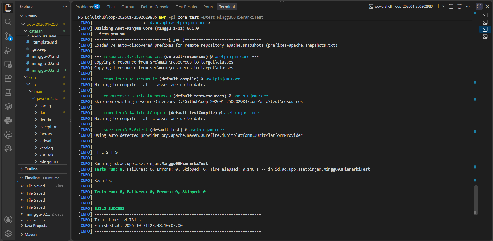

# Catatan Minggu 03: Inheritance

## Yang saya kerjakan
Langkah pertama sebelum mengerjakan yaitu membaca `docs/minggu-03.md`. Selanjutnya saya melengkapi tiga class turunan dari `Aset`, yaitu `Ruang.java`, `Laptop.java`, dan `AlatLab.java`. Sebelum menulis kode, saya pilah dulu mana data yang dipakai semua aset dan mana yang khusus. Kode, nama, status, dan kondisi sudah dikelola `Aset`, jadi tidak saya tulis ulang. Yang saya tambahkan hanya data khusus tiap jenis: kapasitas di `Ruang`, spesifikasi dan nomor inventaris di `Laptop`, serta laboratorium dan tingkat risiko di `AlatLab`.

Di setiap konstruktor, saya memanggil `super(kode, nama)` paling awal supaya kode dan nama langsung diperiksa oleh `Aset`. Dengan begitu, validasi dari minggu 2 tidak perlu saya copy ke tiga class, cukup memanfaatkan induknya. Setelah itu baru saya periksa data khususnya: kapasitas harus lebih dari 0, teks tidak boleh kosong (saya pakai `isBlank()`), dan tingkat risiko tidak boleh null. Data khusus ini saya buat `private final` dan hanya diberi getter.

Terakhir, saya menambahkan `getJenis()` dengan `@Override` di tiap class agar mengembalikan RUANG, LAPTOP, atau ALAT_LAB. Di `Aset`, method ini masih melempar error, jadi harus ditimpa supaya setiap object tahu jenisnya sendiri. Hasilnya, walaupun beberapa jenis disimpan dalam satu `List<Aset>`, jenis aslinya tetap terbaca benar.

## Keputusan desain
Kode, nama, status, dan kondisi saya taruh di `Aset` karena semua jenis aset mempunyai data itu. Kapasitas, spesifikasi, nomor inventaris, laboratorium, dan tingkat risiko hanya masuk akal untuk jenis tertentu, jadi saya taruh di subclass masing-masing. Kalau semuanya digabung di induk, `Ruang` akan punya spesifikasi laptop yang isinya selalu kosong. Dengan begini validasi kode dan nama juga cukup ditulis sekali di `Aset`, dan lewat `super(kode, nama)` otomatis ikut berlaku di semua subclass.

## Inheritance vs Komposisi
Menurut saya inheritance kurang pas untuk jenis aset. Di kode yang saya buat, jenis aset ditentukan oleh class-nya: `Ruang`, `Laptop`, `AlatLab`. Jadi jika ada `Laptop` yang mau dipakai sebagai alat lab, object-nya tidak bisa diubah, harus dibuat ulang. Tiap ada jenis baru juga harus membuat class baru. Jika menggunakan komposisi, jenisnya bisa disimpan sebagai data di dalam `Aset`, jadi lebih fleksibel.

## Kendala
- Saat menjalankan `.\scripts\uji.ps1`, hanya tes minggu 1 yang berjalan karena `minggu-aktif.txt` masih bernilai 1. Saya sudah menjalankan `git fetch upstream`, tetapi belum ada pembaruan. Sama seperti minggu kedua, supaya kode tetap bisa diuji, pada `minggu-aktif.txt` saya mengubah nilainya sementara. Saya juga mencoba cara lain tanpa mengubah file `minggu-aktif.txt`, yaitu menjalankan Maven langsung dengan `mvn -pl core test -Dtest=Minggu03HierarkiTest`, dan keduanya menghasilkan tes sukses
- Saya sempat bimbang apakah `trim()` perlu diterapkan juga ke field di subclass, atau cukup di `kode` dan `nama`. Akhirnya saya terapkan ke semua teks supaya seragam.

## Penggunaan AI
- Alat yang dipakai: Claude
- Bagian yang dibantu AI: Menjelaskan serta mengecek detail tugas pada minggu ini
- Prompt utama: "Jelaskan secara detail tugas tersebut dan apa saja yang harus dilakukan", "Cek apakah kode ini sudah sesuai dengan semua instruksi tugas"
- Yang saya ubah atau tolak dari saran AI, dan alasannya: AI awalnya menyarankan field subclass tidak perlu di-`trim()` karena aturan minggu ini tidak memintanya. Saya memilih tetap menambahkannya agar semua teks konsisten.
- Satu hal yang saya pahami lebih baik sekarang: subclass tidak perlu menulis ulang field induknya. Kode dan nama cukup dikelola `Aset`, sementara `Ruang` menambahkan kapasitas dan memanggil konstruktor induk lewat `super(kode, nama)`.

## Dokumentasi
