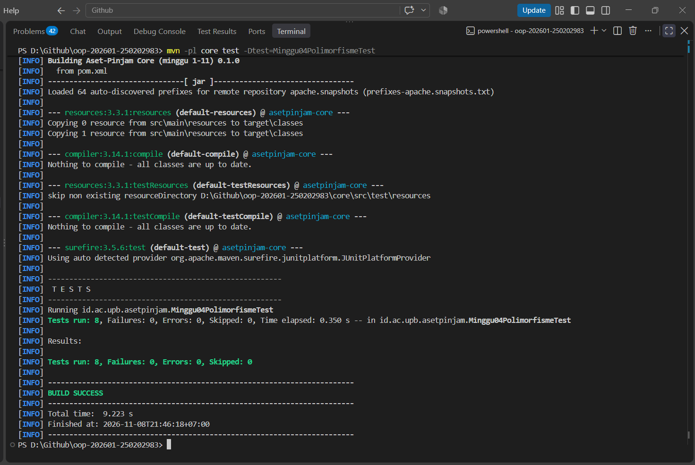

# Catatan Minggu 04: Polymorphism

## Yang saya kerjakan

Setelah membaca `docs/minggu-04.md` dan `Minggu04PolimorfismeTest.java`, saya mengerjakan dua bagian. Pertama, meng-override `hitungDenda(int)` di `Ruang`, `Laptop`, dan `AlatLab`. Rumusnya sama, yaitu hari x multiplier x tarif dasar dari `Varian.aktif().dendaPerHari`, hanya multiplier-nya berbeda: Ruang 1x, Laptop 2x, AlatLab 4x. Nol hari menghasilkan 0, sedangkan hari negatif melempar `IllegalArgumentException`. Hasil perkalian saya jadikan `long` karena `dendaPerHari` bertipe `int` dan `hitungDenda` mengembalikan `long`.
Kedua, saya melengkapi dua overload `cari(...)` di `KatalogAset`. `cari(kata)` mencocokkan nama yang memuat kata tanpa membedakan huruf besar atau kecil (diubah ke huruf kecil dengan `Locale.ROOT`). `cari(kata, jenis)` memanggil `cari(kata)` lalu menyaring berdasarkan jenis, sehingga aturan pencocokan hanya ditulis sekali.

## Keputusan desain

Tidak ada keputusan khusus minggu ini karena aturannya sudah pasti. Satu pilihan kecil saya: kata atau jenis yang `null` pada `cari(...)` ditolak dengan `IllegalArgumentException`, konsisten dengan minggu sebelumnya.

## Kendala

- Kendala saya minggu ini adalah memahami materi dan aturannya terlebih dahulu. Overriding dan overloading baru saya pelajari, jadi di awal saya masih sulit membedakan keduanya. Saya baru bisa melengkapi kode setelah paham bahwa overriding itu mengganti isi method induk di subclass (versinya dipilih saat program berjalan sesuai object aslinya), sedangkan overloading itu beberapa method bernama sama dalam satu class dengan parameter berbeda.
- saya menjalankan `mvn -pl core test -Dtest=Minggu04PolimorfismeTest` karena `minggu-aktif.txt` masih minggu 1, sehingga `.\scripts\uji.ps1` belum menjalankan tes minggu 4.

## Penggunaan AI

- Alat yang dipakai: Claude
- Bagian yang dibantu AI: Penjelasan penerapan polymorphism, overriding, dan overloading, serta membantu pengecekan error kode dan memastikan kode sesuai dengan instruksi
- Prompt utama: 
    - Jelaskan tugas `docs/minggu-04.md` apa inti dan tujan dari tugasnya
    - Apa itu overriding, overloading, dan dynamic binding
    - Apakah pengerjaan kode tersebut sudah sesuai dengan aturan di minggu 4
- Yang saya ubah atau tolak dari saran AI, dan alasannya: AI menjelaskan apa yang saya tanyakan di bagian prompt utama dan tidak ada yang saya ubah atau tolak karena menurut saya sudah sesuai
- Satu hal yang saya pahami lebih baik sekarang: Overriding menentukan versi method saat program berjalan berdasarkan object aslinya, sedangkan overloading ditentukan dari parameter. Untuk aturan yang berulang di banyak subclass seperti denda, komposisi lebih fleksibel. 

## Dokumentasi
