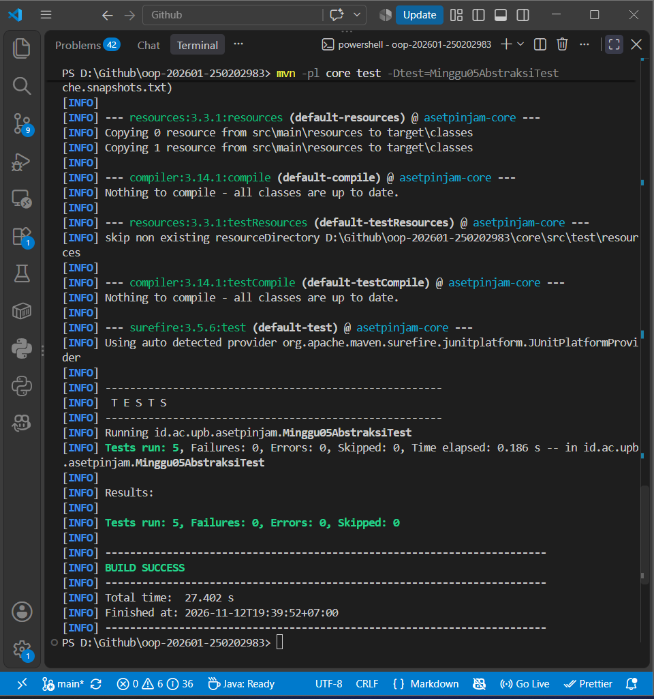

# Catatan Minggu 05: Abstraction

## Yang saya kerjakan

Setelah membaca `docs/minggu-05.md` dan `Minggu05AbstraksiTest.java`, saya mengerjakan dua bagian. Pertama, di `Aset.java` saya mengisi `bisaDipinjam()` agar bernilai true hanya jika status TERSEDIA dan kondisi bukan RUSAK_BERAT. `Aset` sudah mengimplementasikan interface `DapatDipinjam`, jadi saya hanya mengisi method-nya. Setelah itu `Aset` saya jadikan `abstract class` dan `hitungDenda(int)` saya ubah menjadi method abstrak, karena cara menghitung denda berbeda untuk tiap jenis aset dan sudah di-override di `Ruang`, `Laptop`, dan `AlatLab`.

Kedua, saya mengimplementasikan interface `AturanDenda` di dua class. `DendaFlat` mengembalikan `aset.hitungDenda(hari)`. `DendaProgresif` mengambil denda flat lalu menambahkan persentase bertingkat: 0% untuk hari 1-2, 15% untuk hari 3-5, 30% untuk hari 6-10, dan 60% untuk hari 11 ke atas. Karena basisnya tetap `hitungDenda`, multiplier jenis dan tarif varian ikut terbawa.

## Keputusan desain

Rumus progresif adalah keputusan saya sendiri. Saya memilih persentase bertingkat karena ada masa tenggang 2 hari sebelum tambahan berlaku. Rumus ini memenuhi syarat tes. Keputusan ini saya catat di `docs/asumsi.md` (AL-02).
`Aset` saya jadikan abstract class karena menyimpan field dan kode yang dipakai bersama (kode, nama, status, `bisaDipinjam()`). Sebaliknya `AturanDenda` berupa interface karena hanya kontrak perilaku "bisa menghitung denda" yang bisa diisi banyak cara tanpa menyimpan data. 

## Kendala

Kendala yang saya alami adalah saat menentukan rumus denda progresif. Awalnya, saya menggunakan denda flat untuk 7 hari pertama, kemudian menambahkan 50% dari denda untuk sisa hari keterlambatan. Namun, setelah mempertimbangkan kembali, saya memutuskan untuk menggunakan persentase bertingkat berdasarkan lama keterlambatan. Saya sempat bingung menentukan batas hari dan persentase tambahan yang sesuai agar denda tetap memenuhi ketentuan pengujian.

## Penggunaan AI

- Alat yang dipakai: Claude
- Bagian yang dibantu AI: memahami instruksi tugas minggu 5 dan cara menentukan rumus denda progresif.
- Prompt utama: 
    - Jelaskan tugas minggu 5
    - fungsi abstract class dan interface?
    - Kalo pake masa tenggang, terus dendanya naik bertahap aja gimana?
- Yang saya ubah atau tolak dari saran AI, dan alasannya:  AI menyarankan tambahan denda sebesar 50% setelah keterlambatan 7 hari. Saya memilih menggunakan persentase bertingkat seperti keputusan saya yang sudah dijelaskan diatas.
- Satu hal yang saya pahami lebih baik sekarang: abstract class cocok untuk berbagi state dan kode antar subclass, sedangkan interface cocok untuk kontrak perilaku yang bisa diganti-ganti, seperti aturan denda.

## Dokumentasi
