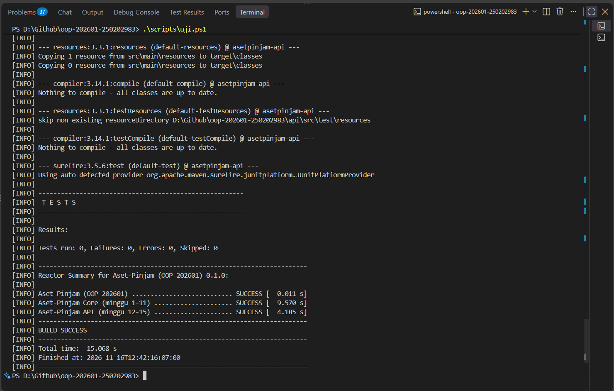

# Catatan Minggu 07: Koleksi

## Yang saya kerjakan

Minggu ini saya mengisi empat method yang sebelumnya masih kosong di `JadwalPeminjaman`, yaitu `bentrok`, `semuaUrutMulai`, `perAset`, dan `hapus`. Pada `bentrok`, saya memeriksa terlebih dahulu apakah kode asetnya sama, kemudian melihat apakah rentang waktunya tumpang tindih. Untuk `semuaUrutMulai`, saya menyalin daftar terlebih dahulu lalu mengurutkan salinannya dengan `Comparator`. `perAset` saya buat dengan `LinkedHashMap` agar urutan aset tetap mengikuti urutan masuk, sedangkan `hapus` cukup menggunakan `removeIf` berdasarkan id. Selain itu, saya menambahkan tiga tes sendiri di `BatasBentrokTest.java` untuk kasus batas waktu dan mencatat keputusannya di `docs/asumsi.md` bagian A-01.

## Keputusan desain

Saya memilih batas waktu setengah terbuka, sehingga peminjaman 09:00-11:00 dan 11:00-13:00 tidak dianggap bentrok karena aset sudah dapat dipakai kembali tepat pada pukul 11:00. Tes yang saya tulis mencakup dua urutan, yaitu peminjaman baru sesudah maupun sebelum, ditambah satu tes selisih satu menit yang tetap bentrok.

Mengenai struktur data, saya tidak menambahkan Map atau Set internal. Saya tetap menggunakan satu `List` saja karena jumlah datanya masih sedikit dan lebih mudah dijaga konsistensinya. Map hanya muncul sebagai hasil `perAset`, bukan disimpan secara permanen.

Perbandingan aset juga saya lakukan melalui `getKode()`, bukan `equals` objek. Alasannya, pada tes objek `Ruang` dibuat baru meskipun kodenya sama, sehingga perbandingan dengan `equals` berpotensi salah.

## Kendala

Bagian yang cukup membingungkan saat mengerjakan yaitu menentukan perilaku bentrok di batas waktu. Awalnya saya sempat berpikir bahwa peminjaman yang selesai tepat saat peminjaman lain mulai tetap bentrok, tetapi setelah ditinjau kembali aset pada saat itu sudah bebas. Akhirnya saya memutuskan keduanya tidak bentrok dan menuliskannya dalam tes agar keputusan tersebut jelas.

Saya juga hampir salah pada `semuaUrutMulai`. Ternyata `sort` pada list mengubah list aslinya, sehingga jika tidak disalin terlebih dahulu urutan data di dalam jadwal ikut berubah. Karena itu saya menyalinnya ke `ArrayList` baru sebelum diurutkan.

Untuk `perAset`, saya cukup lama memastikan urutan kunci hasilnya tetap stabil karena `HashMap` tidak menjamin urutan. Setelah diganti ke `LinkedHashMap`, hasilnya sesuai dengan urutan aset saat pertama kali muncul.

## Penggunaan AI

- Alat yang dipakai: Claude
- Bagian yang dibantu AI: Implementasi kode dan penjelasan logika bentrok di batas waktu dan efek `sort` terhadap daftar asli.
- Prompt utama: "Jelaskan kenapa mengurutkan list dengan `sort` bisa mengubah daftar asli, dan bagaimana cara menyalinnya sebelum diurutkan."
- Yang saya ubah atau tolak dari saran AI: Saya sempat disarankan menambahkan Map per aset agar pencarian lebih cepat, tetapi saya menolaknya karena data masih sedikit dan akan ada dua sumber data yang harus dijaga tetap sinkron. Saya tetap menggunakan satu `List`.
- Satu hal yang saya pahami lebih baik sekarang: untuk mengurutkan tanpa merusak data asli, list perlu disalin terlebih dahulu, dan `LinkedHashMap` dapat digunakan apabila urutan kunci hasil pengelompokan ingin tetap terjaga.

## Dokumentasi

