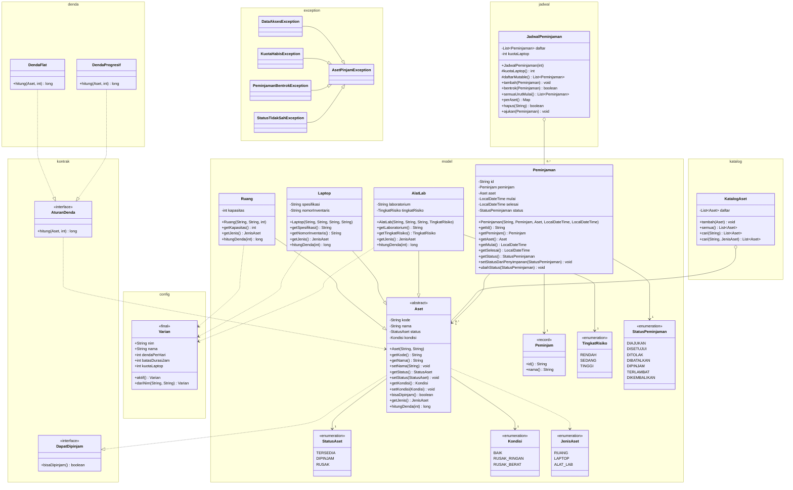

# Class Diagram Aset-Pinjam (modul core)

Diagram ini mengikuti kode yang ada di `core/src/main/java`. Isinya fokus ke bagian domain yang sudah dipakai: model, kontrak, denda, katalog, jadwal, varian, dan exception. Kelas yang masih berupa kerangka untuk minggu 10-11 (`LayananDenda`, `AsetFactory`, dan DAO) belum saya gambar supaya diagram tidak menampilkan sesuatu yang belum benar-benar jalan.

Versi gambar: [`class-diagram.svg`](class-diagram.svg).

## Keterangan relasi

- `KatalogAset` dan `JadwalPeminjaman` berelasi **aggregation** (`o--`). Objek `Aset` dan `Peminjaman` dibuat di luar lalu dimasukkan lewat `tambah(...)`, jadi objeknya tetap bisa hidup tanpa wadah tersebut.
- `Peminjaman` ke `Aset` dan `Peminjam` adalah **association** dengan multiplicity 1. Konstruktor `Peminjaman` menolak null, jadi satu peminjaman wajib punya satu aset dan satu peminjam.
- Di kode ini belum ada **composition** murni. `status` dan `kondisi` pada `Aset` cuma enum, bukan objek terpisah yang dimiliki `Aset`. Relasi ke `Peminjam` juga bukan composition karena `Peminjam` bisa dipakai di banyak peminjaman.
- `Ruang`, `Laptop`, dan `AlatLab` punya **dependency** ke `Varian` karena `hitungDenda` membaca `Varian.aktif().dendaPerHari`.
- `DendaFlat` dan `DendaProgresif` mengimplementasikan `AturanDenda`, lalu `AturanDenda` bergantung pada `Aset` karena method `hitung` menerima parameter `Aset`.
- Tipe asli `JadwalPeminjaman.perAset()` adalah `Map<String, List<Peminjaman>>`. Di Mermaid saya tulis `Map` saja supaya sintaks diagramnya tidak rumit.
- Method `bentrok` dan `ajukan` sudah ada di kode sebagai kerangka minggu 7 dan 9, jadi tetap saya cantumkan di diagram.