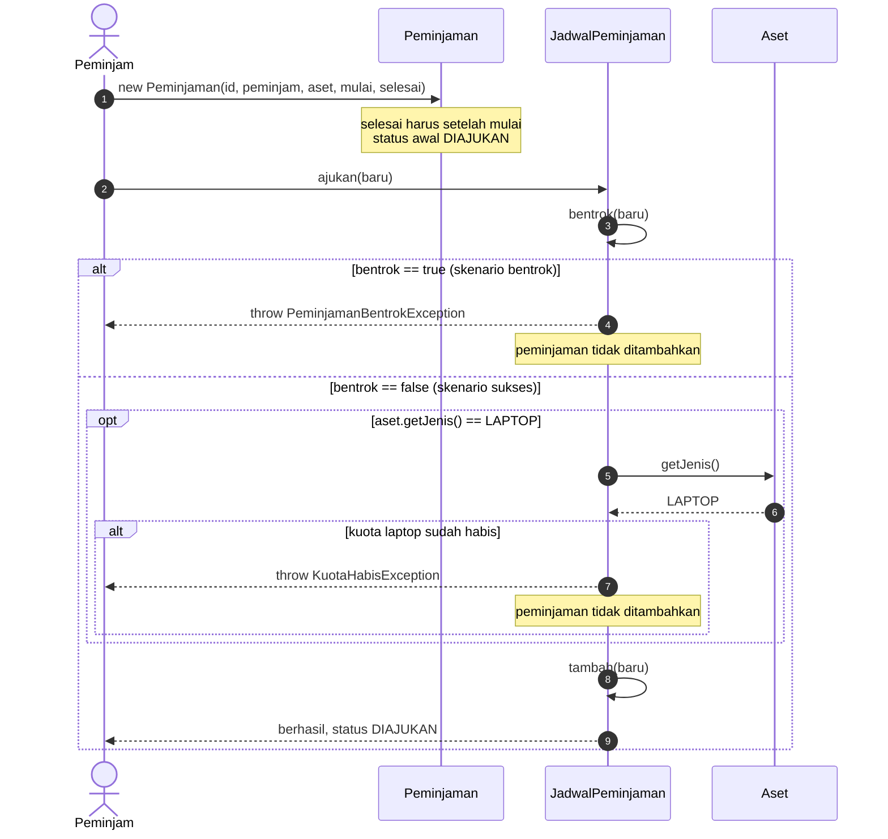

# Sequence Diagram: Pengajuan Peminjaman

Alur ini mengikuti kontrak method `JadwalPeminjaman.ajukan(Peminjaman)` dan aturan di `docs/aturan-bisnis.md`: cek bentrok pada aset yang sama, cek kuota laptop, lalu tambahkan peminjaman. Skenario sukses dan bentrok dipisahkan dengan fragmen `alt`.

Versi gambar: [`sequence-pengajuan.svg`](sequence-pengajuan.svg).

